# Bank of America Deposit Market Share in Arkansas Campus Counties

Author: Nuzhat Faizah

## Summary

Bank of America lost deposit market share in all five campus counties where it had branches in 2010, according to FDIC data from June 30, 2010 to June 30, 2026. The project compares 13 counties that host University of Arkansas System campuses and tests each county against a statewide benchmark. Deposits grew in the three counties where the bank remains, so the loss comes from slower growth than the counties and not from falling deposits.

## Business problem

Bank of America's Arkansas branch network fell from 42 branches in 2010 to 16 in 2026, while deposits in the state more than doubled. A branch network strategy team must decide which markets to defend, which to invest in, and which are at risk of exit. The project measures where the bank is losing deposit share, how much closures and competitors explain, and which campus county markets deserve action first.

The project is framed as a branch network analysis for a bank strategy team. It is a portfolio project and not a client engagement.

## Why the project exists

A personal experience started the question. As an international student with an I20, I was told at a Bank of America branch that I needed a Social Security number to open an account, and friends described service problems in Little Rock. Anecdotes cannot show a trend, so the project looks for evidence in public data.

Federal customer identification rules (31 CFR 1020.220) let a bank accept a passport number and country of issuance from a person who is not a U.S. person. Bank of America's own consumer guidance says an SSN is not always required. An SSN requirement at one branch therefore reflects bank practice and not federal law, and the data in this project do not measure that practice.

## Research question

Is Bank of America losing deposit market share in the Arkansas counties that host University of Arkansas System campuses, and how do those counties compare with its statewide trend? The project asks four sub questions.

1. What happened in the campus counties, and which banks gained share?
2. Do the campus counties differ from the state?
3. Do branch closures cost deposits, and did Chase gain ground?
4. Do local traits, such as international students and residents born abroad, line up with gains and losses?

## Findings

1. Share fell in all five counties the bank served in 2010. Pulaski County fell from 25.0 to 17.6 percent, Washington from 5.1 to 3.9, and Jefferson from 7.2 to 4.1. Boone County left through a 2013 sale to Arvest Bank, and Independence County left through a closure between 2013 and 2014.
2. Jefferson stands out below both benchmarks, Washington sits moderately below them, and Pulaski is close to the rest of Arkansas. The statewide share fell from 6.4 to 5.7 percent. Pulaski holds 82 percent of the bank's Arkansas deposits, so the statewide line mostly reflects Pulaski.
3. Closures show no clear link to the share drops. The two Pulaski branches closed in May 2022 held 3.6 percent of the bank's Pulaski deposits in June 2021, while the county share fell 4.8 points in that window. Chase held under 0.8 percent of deposits in Pulaski and Washington by 2026, so it cannot explain most of the decline.
4. The three counties that kept Bank of America have higher international student shares in fall 2024, from 3.6 to 4.3 percent, than the two that lost it, at 0.8 and 0.05 percent. The non citizen share points the same way only as a group, because Jefferson at 1.1 percent sits below Independence at 2.8 percent. The sample is five counties, so the result is a case study and not a test. In the eight counties without a branch, local banks lead, and Phillips County fell from three banks to two.

## Recommendations

The four recommendations below come from the dashboard pages and from the checks stored in the evidence folder. Each one names the numbers behind it and states how strongly the data supports it. Recommendations 3 and 4 rest on few counties, so they are tests to run and not conclusions.

1. Because Simmons Bank's main office added $1.9 billion in Jefferson County between 2016 and 2018 while Bank of America's deposits there stayed near $90 million, Bank of America should track deposit dollars next to share in every county and check where competitors book deposits, so that a booking change is not mistaken for lost customers. The evidence is strong. Stage 6b results show the flat deposits, the competitor surge, and the main office row, and the Pulaski check shows the same pattern at Bank OZK.

2. Because Pulaski County held 75.8 percent of the bank's Arkansas deposits in 2010 and 81.6 percent in 2026, the bank should monitor Pulaski's share of statewide deposits and set a warning level that triggers a review, so that trouble in one county does not put most of its Arkansas deposits at risk. The evidence is strong, because Stage 6a measures the concentration directly. The bank decides the level, since the data gives no basis for a number.

3. Because Bank of America's Jefferson deposits held after a branch closed in 2016, while its Independence deposits fell 100 percent when its only branch there closed, the bank should check whether another branch stays in the county before closing a branch, so that it does not lose a county's deposits. The evidence is moderate. Page 4 and Stage 7b cover nine closure events, which is a small sample.

4. Because Polk County has a 3.9 percent international student share and no Bank of America branch, while Boone and Independence left with shares under 1 percent, the bank should test demand with a small, low cost step before opening a branch in any campus county, so that it does not expand on student numbers alone. The evidence is moderate to weak. Page 3 covers five served counties, and Polk shows that student share alone does not explain where the bank operates.

## Data

* FDIC Summary of Deposits for Arkansas, June 30, 2010 to June 30, 2026, with 23,057 branch rows.
* American Community Survey 5 year estimates, table B05002, for the 2010 to 2014, 2015 to 2019, and 2020 to 2024 windows.
* IPEDS Fall Enrollment for 15 campuses in fall 2010, 2014, 2019, and 2024.

## Method

The pipeline runs in SQL Server, and Power BI reads the finished views. Raw files load into text staging tables, a cleaning step converts them to numbers and dates, and views calculate market share, rank, benchmarks, closures, and county profiles. Market share is one bank's branch deposits divided by all branch deposits in the same county and year.

The stages run in this order.

1. Create the database and staging schema.
2. Create the raw staging table and load the Summary of Deposits files.
3. Clean the deposit table and build the branch key.
4. Build market share and rank views for the campus counties.
5. Build the statewide and rest of state benchmarks.
6. Classify each branch as stayed, closed, or sold, and compare Chase.
7. Load and clean the ACS tables.
8. Load the IPEDS file and join campuses to counties.
9. Build the final county profile and the view for counties without a branch.

A branch counts as closed when its FDIC unique number appears on June 30 of one year and not on June 30 of the next, unless it reappears under another bank, which counts as a sale.

## Verified facts and sources

Several facts in the project came from notes and were checked before publication.

* Arvest purchase. Arvest announced in December 2012 that it would buy nine Bank of America locations in Arkansas, and the sale closed in March 2013. The deposit data shows eight branch numbers moving to Arvest by June 30, 2013, and the data cannot show which announced location is missing.
* Downtown Little Rock lobby branch. The bank announced on March 7, 2018 that it would close the lobby branch in its downtown building on July 31, 2018. The deposit data shows about $2.39 billion booked at the downtown office in June 2018 and about $3.06 billion at the 200 Main Street branch in North Little Rock in June 2019. Both offices are in Pulaski County, so the project treats the change as a reassignment of deposits and not as a loss of customers.
* Dickson Street, Fayetteville. The OCC lists a Bank of America branch closing at 703 West Dickson Street, named University of AR BC, with notice received on February 17, 2022 and closing effective May 31, 2022. The branch at 4024 West Markham in Little Rock, named UAMS Med School Branch, closed on the same date. The Bank of Fayetteville train branch at 542 West Dickson Street is a different bank's branch, and local television reported it closed in September 2023.

Sources, cited by publication and date.

* Roby Brock, "Arvest Bank Acquiring 29 Locations From Bank of America," Talk Business & Politics, December 13, 2012.
* David Smith, news brief, Arkansas Democrat-Gazette, February 20, 2013.
* David Smith, "Bank of America to close branch in lobby of its namesake building in downtown Little Rock," Northwest Arkansas Democrat-Gazette, March 7, 2018.
* "Dickson Street Bank Robbed," Northwest Arkansas Democrat-Gazette, June 16, 2011, which confirms the branch address.
* Office of the Comptroller of the Currency, Weekly Bulletin for 02/13/2022 to 02/19/2022 and for 05/29/2022 to 06/04/2022, application numbers 2022-LB-BRANCHCLOSING325600 and 2022-LB-BRANCHCLOSING325599.
* Code of Federal Regulations, Title 31, section 1020.220, and Bank of America, Better Money Habits, international student bank account page.
* University of Arkansas System campus pages, which list join years for North Arkansas College (2026), UA East Arkansas Community College (2024), and UA Pulaski Technical College (2017).

## Limits

The results describe five counties and show association, not cause. Branch deposits are booked where a bank chooses, so branch totals can move without customers moving, which is why the project uses county totals. Pulaski County share moved between 15.0 and 27.8 percent during the period, so the change from 2010 to 2026 depends on the end year. Credit unions are not in the Summary of Deposits, online only banks book deposits at headquarters, and the Census estimates for small counties carry wide margins of error.

Jefferson County shows how booking can distort even a county share. Bank of America's deposits there stayed near $90 million from 2016 to 2018, while its share fell from 6.6 to 2.7 percent. Simmons Bank added about $1.9 billion in the same years, and the increase sits at its Pine Bluff main office while its two branches stayed flat. The data cannot identify the cause, so a falling share is not proof of lost customers. Three result screenshots document the check.

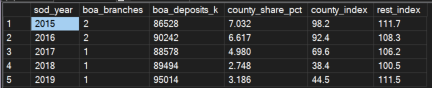

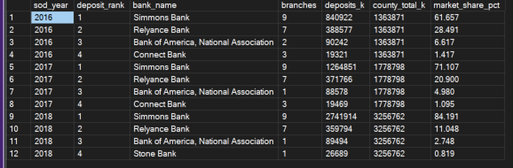

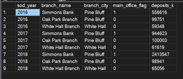

Pulaski County shows the same pattern at a larger scale. The main office of Bank OZK in Little Rock held $366 million in 2010, $2.99 billion in 2016 and $6.58 billion in 2026, while its branches stayed under $175 million. Deposits booked at a headquarters office likely explain much of the rise of Bank OZK to first place and part of the fall in the Bank of America share. The data cannot show how many of those deposits come from customers in the county.

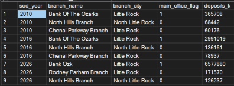

A sensitivity check removes the Bank OZK main office from the county total. The Bank of America share then moves from 26.0 percent in 2010 to 22.8 percent in 2026, a drop of about 3 points instead of 7.4. The direction of the result holds, and its size depends on where one competitor books deposits.

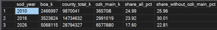

The campus list reflects University of Arkansas System membership in 2026, and some campuses joined the system during the study period. International student counts are small, and IPEDS counts online students who may not live in the campus county.

## How to reproduce

The three source folders hold the downloaded files, and the scripts load them in the order above. A few file details matter.

* The Summary of Deposits files for 2010 to 2025 end rows with a line feed, and the 2026 file ends rows with a carriage return and a line feed.
* The ACS file names use a dot before B05002, and the code for "Not a U.S. citizen" is B05002_015 in the 2014 file and B05002_021 in the 2019 and 2024 files.
* The IPEDS file has no line break after its last row, and SQL Server skips that row. One line break was added to a copy of the file, named with the word prepared, and the original is unchanged.

Press articles and bulletins are cited and not redistributed in this repository.

## Dashboard

The Power BI dashboard has six pages. Pages 1 to 4 answer the research questions, and Pages 5 and 6 add market detail. Each page opens with a sentence that states the finding, followed by a chart and a table or a second chart. The charts read the finished SQL views, so the numbers match the SQL results.

Page 1 shows the deposit share of Bank of America in the five counties it served in 2010.

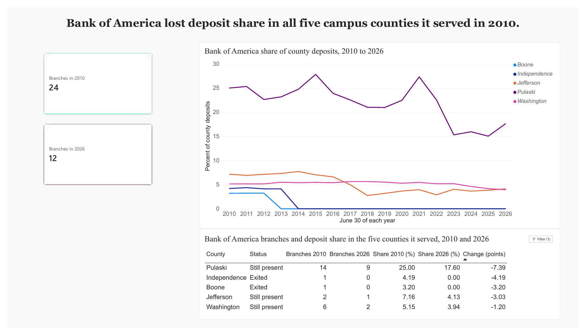

Page 2 compares each county with the rest of Arkansas, using an index where 2010 equals 100.

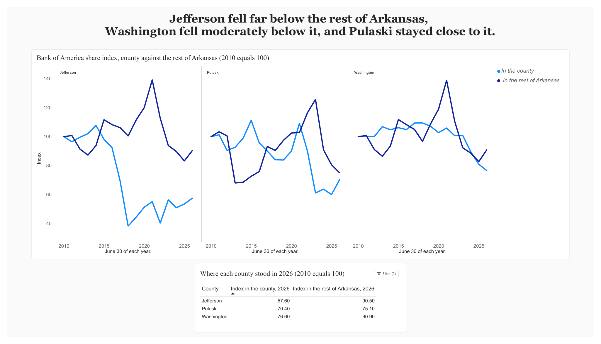

Page 3 compares international student shares and the foreign born population across all 13 campus counties.

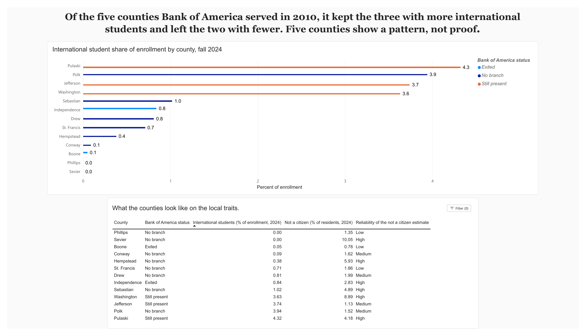

Page 4 shows the branches the bank lost each year, the size of Chase in the two counties it entered, and whether closing branches cost deposits.

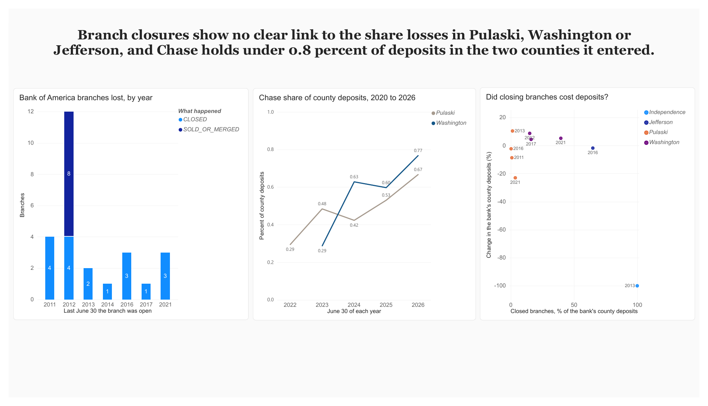

Page 5 shows who holds deposits in Pulaski County, the largest campus county, and how the ranking changed from 2010 to 2026.

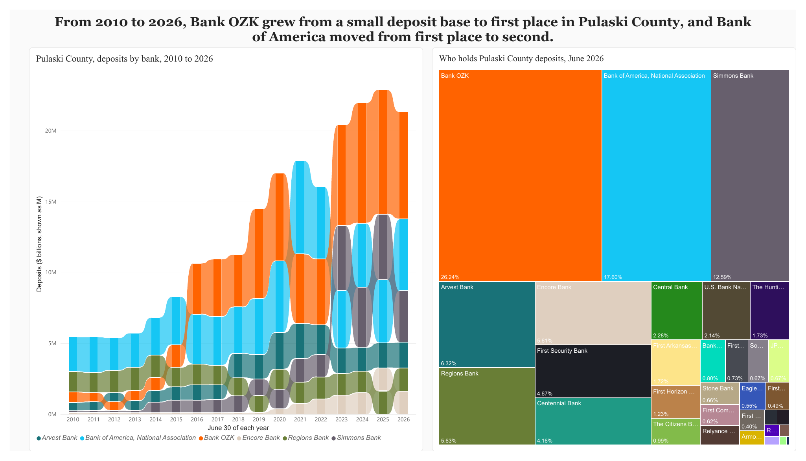

Page 6 shows the Bank of America deposit share for all 13 campus counties in every year. The bank holds no deposits in eight of them.

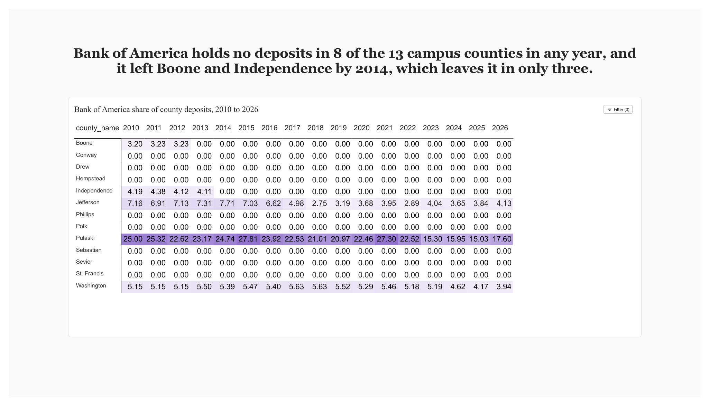

## Repository contents

* `sql/ArkansasBankStudy_pipeline.sql` holds the commented SQL Server pipeline, in the order described above.
* `evidence/` holds result screenshots from the Jefferson County and Pulaski County checks.
* `dashboard/` holds the six page images, a PDF of the dashboard, and the Power BI file.
* `memo/` holds the one page strategy memo.
* `README.md` is this file.

The raw data files are not stored here. They are public, and the Data section above names each source.
